# Master Engineering Corpus: Engine Map

**Repository:** [auctoroaa/NVIDIA-MADE-NOTE-BOOK](https://github.com/auctoroaa/NVIDIA-MADE-NOTE-BOOK)  
**Corpus scope:** Engines and reusable components first  
**Last reviewed:** 2026-10-21  
**Rule:** AXIOM-000 — Do not prematurely destroy potentially useful information.

> This document is an evidence-aware index, not a claim that every named engine is implemented. Names, intended boundaries, and runnable code are tracked separately.

## Status vocabulary

- **SOURCE-DEFINED** — a specification, design document, or source artifact defines the component. This does not imply it runs.
- **PROPOSED** — a candidate architecture or extraction idea; no canonical implementation has been established here.
- **UNRESOLVED** — provenance, scope, ownership, or implementation state needs investigation.
- **IMPLEMENTATION-VERIFIED** — source code and a relevant verification result have been inspected. The status applies only to the stated scope, not to the entire product.

## Corpus map

```mermaid
flowchart TD
    CORPUS["MASTER ENGINEERING CORPUS"]

    CORPUS --> REALITY["Deterministic State / Reality"]
    CORPUS --> EVOLVE["Evolution & Search"]
    CORPUS --> MEMORY["Memory / Archive / Paging"]
    CORPUS --> VERIFY["Verification / Evidence"]
    CORPUS --> SIM["Physics / Simulation"]
    CORPUS --> EXEC["Scheduling / Execution"]
    CORPUS --> INTEL["Agent & Provider Integration"]

    REALITY --> AXIOM["AXIOM Reality Engine"]
    REALITY --> PRNG["Canonical PRNG"]
    REALITY --> STATE["State model / state identity"]

    EVOLVE --> EVO["EVOLUTION Engine"]
    EVOLVE --> CURIOSITY["Curiosity / exploration"]
    EVOLVE --> HYBRID["Hybridization / recombination"]
    EVOLVE --> LINEAGE["Lineage / selection archive"]

    MEMORY --> MIE["MIE: Memory Illusion Engine"]
    MEMORY --> PAGER["StatePager"]
    MEMORY --> CACHE["TileCache / bounded LRU"]

    VERIFY --> ZERO["ZERO Verification Engine"]
    VERIFY --> HASH["Hash chain / state digests"]
    VERIFY --> WAL["WAL integrity / recovery checks"]

    SIM --> PHYS["Physics / Reality Simulation"]
    SIM --> RK["RK4 / RK45 integrators"]
    SIM --> REPLAY["Deterministic replay"]

    EXEC --> DAG["DAG Scheduler"]
    EXEC --> TX["Transactional tick / rollback"]

    INTEL --> ROUTER["Agent Routing Engine"]
    INTEL --> ADAPTER["Provider adapters"]
    INTEL --> WORKSHOP["Notebook / Workshop runtime"]

    AXIOM -. "source-backed subset" .-> HASH
    AXIOM -. "source-backed subset" .-> WAL
    AXIOM -. "source-backed subset" .-> DAG
    AXIOM -. "source-backed subset" .-> TX

    classDef verified fill:#d9f2e6,stroke:#26734d,color:#143d2a
    classDef source fill:#dceafe,stroke:#3568a8,color:#17345c
    classDef proposed fill:#fff0cc,stroke:#a87816,color:#5c410b
    classDef unresolved fill:#eeeeee,stroke:#777,color:#333
    class AXIOM,HASH,WAL,DAG,TX verified
    class EVO,MIE,ZERO,PHYS source
    class PRNG,STATE,CURIOSITY,HYBRID,LINEAGE,PAGER,CACHE,RK,REPLAY,ROUTER,ADAPTER,WORKSHOP proposed
```

**Diagram caution:** The graph shows conceptual relationships and candidate reuse paths. A connecting line is not proof of a working integration. The color of a family node is not a product-wide certification.

## Engine registry

| ID | Engine / component | Role | Status | Provenance and limits |
|---|---|---|---|---|
| ENG-001 | **AXIOM Reality Engine** | Deterministic state transitions, scheduling, transactions, integrity, persistence/recovery | **IMPLEMENTATION-VERIFIED** for the listed subset | [Solvor repository](https://github.com/auctoroaa/Solvor), source document: [AXIOM_REALITY_ENGINE_SINGLE.md](https://github.com/auctoroaa/Solvor/search?q=AXIOM_REALITY_ENGINE_SINGLE.md&type=code). Inspected scope includes deterministic DAG ordering, declared tile-conflict checks, transactional tick updates/rollback, SHA-256 state digests/hash-chain verification, CRC32C WAL records, recovery checks, and a bounded pin-aware LRU TileCache with tests. Not a claim that all planned integrations are finished. |
| ENG-002 | **EVOLUTION Engine** | Candidate generation, evaluation, selection, novelty, lineage and iterative improvement | **SOURCE-DEFINED** at design level; runtime **UNRESOLVED** | Referenced in the NOESIS / EVOLUTION X design material and prior project notes. Canonical source path and a complete runnable generation loop have not been established in this registry. |
| ENG-003 | **ZERO Verification Engine** | Independent validation, integrity checks, replay/evidence verification | **SOURCE-DEFINED** at design level; standalone implementation **UNRESOLVED** | Referenced in AXIOM / DIVINE JUDGEMENT architecture notes. Do not treat the AXIOM hash/WAL checks as proof that a separate ZERO product is complete. |
| ENG-004 | **MIE (Memory Illusion Engine)** | Memory-budgeted tensor paging, caching and offload across storage/RAM/VRAM | **SOURCE-DEFINED** at design level; implementation **UNRESOLVED** | Referenced in EVOLUTION X / ApexOverlordOmega design notes. TensorTile, TensorPager, async prefetch and OffloadedLinear are candidate components until canonical code is located and tested. |
| ENG-005 | **Physics / Reality Simulation Engine** | Numerical integration, state evolution, deterministic replay and physical invariants | **SOURCE-DEFINED** across project designs; shared engine status **UNRESOLVED** | Keep the AXIOM pendulum prototype separate from DIVINE JUDGEMENT's coupled simulation until source and interfaces prove they are one reusable implementation. |
| ENG-006 | **DAG Scheduler** | Dependency ordering and declared resource-conflict checks | **IMPLEMENTATION-VERIFIED** within AXIOM's inspected subset | Not yet established as an independently packaged scheduler. |
| ENG-007 | **Transactional Tick / Rollback** | Apply state changes atomically and restore prior state on failure | **IMPLEMENTATION-VERIFIED** within AXIOM's inspected subset | Independent extraction and API are not yet established. |
| ENG-008 | **State Digests / Hash-Chain Verifier** | Deterministic state identity and chain integrity | **IMPLEMENTATION-VERIFIED** within AXIOM's inspected subset | SHA-256 state digests and hash-chain verification are source-backed; broader certification is separate. |
| ENG-009 | **WAL / Recovery Validator** | CRC32C-protected write-ahead log records, replay validation and invalid-tail handling | **IMPLEMENTATION-VERIFIED** within AXIOM's inspected subset | Segment rotation and full StatePager integration remain unfinished in the inspected design notes. |
| ENG-010 | **TileCache** | Bounded LRU cache with pin-aware eviction | **IMPLEMENTATION-VERIFIED** within AXIOM's inspected subset | Cache exists, but backing-store integration was not complete in the inspected notes; active state remained in an in-memory map. |
| ENG-011 | **StatePager** | Bounded persistent state access / paging | **PROPOSED / UNRESOLVED** | Planned AXIOM component. Full integration and optional io_uring path are not verified. |
| ENG-012 | **Canonical PRNG** | Seeded deterministic random sequences | **UNRESOLVED** as a reusable standalone component | A seeded SplitMix64 is documented for DIVINE JUDGEMENT; do not assume it is shared with AXIOM or EVOLUTION. |
| ENG-013 | **Curiosity / Exploration Engine** | Propose experiments, explore candidate space, surface anomalies | **PROPOSED** | Design strand only until a source file and tests are located. |
| ENG-014 | **Hybridization Engine** | Recombine candidate solutions or genomes | **PROPOSED** | Design strand only until a source file and tests are located. |
| ENG-015 | **Lineage / Archive Engine** | Preserve ancestry, provenance and experiment history | **SOURCE-DEFINED** at architecture level; implementation **UNRESOLVED** | NOESIS / CODEX VERDANT architecture. The current repository's crate boundary is a scaffold, not a completed archive backend. |
| ENG-016 | **Agent Routing Engine** | Decompose tasks and select specialist agents | **PROPOSED** | Orca Gang / AI workspace direction. No verified shared router implementation is linked here yet. |
| ENG-017 | **Provider Adapter Engine** | Route requests to model APIs, NVIDIA services, GitHub and execution providers | **PROPOSED** | Intended Notebook / Workshop capability. A notebook API smoke-test file exists in this repository, but that alone does not establish a general provider adapter layer. |
| ENG-018 | **CODEX VERDANT workspace crates** | Core, ingestion, embedding, storage, evolution, governance, GPU, vector and API boundaries | **SOURCE-DEFINED; scaffold only** | [Current repository README](../README.md) explicitly says this workspace is a scaffold. The crate `component_info()` functions report `implemented: false`; names are intended boundaries, not completed capabilities. |

## Reusable components and boundaries

### Source-backed AXIOM subset

- Deterministic DAG task ordering.
- Declared tile-access conflict checks.
- Transactional tick updates and rollback.
- SHA-256 state digests and hash-chain verification.
- CRC32C-protected WAL records and restart recovery validation.
- Bounded, pin-aware LRU TileCache with tests.

**Known limits from the inspected notes:** TileCache is not fully integrated as the persistent backing store; active state remains in an in-memory map. WAL segment rotation, complete StatePager integration, optional io_uring, and broader fault-injection/concurrency coverage remain unfinished.

### CODEX VERDANT repository scaffold

The current Rust workspace defines these intended boundaries:

- `codex-core`
- `codex-ingestion`
- `codex-embedding`
- `codex-storage`
- `codex-evolution`
- `codex-governance`
- `codex-gpu`
- `codex-vector`
- `codex-api`
- `codex-app`

These are **scaffold-only**, according to the repository README and crate status functions. Do not relabel them implementation-verified just because they compile or have crate directories.

## Extraction rules

1. **Trace before copying.** Record the originating repository, exact path, commit/ref, and relevant tests.
2. **Separate concept from code.** A design name does not establish an implementation.
3. **Do not merge by name alone.** For example, AXIOM's physics prototype and DIVINE JUDGEMENT's simulation may share methods without sharing code.
4. **Extract only after contracts are clear.** Define inputs, outputs, state ownership, determinism guarantees, error handling, and tests before promoting a subcomponent to a shared crate.
5. **Keep the source of truth.** The original project remains authoritative until an extraction has tests showing equivalent behavior.
6. **Upgrade status only with evidence.** Link the implementation and the specific passing test/build or runtime evidence.

## Next audit queue

- [ ] Locate canonical EVOLUTION X / ApexOverlordOmega source documents and record exact paths.
- [ ] Locate ZERO verification source and distinguish it from AXIOM's built-in verification subset.
- [ ] Locate MIE / TensorPager implementation files, if any.
- [ ] Inspect DIVINE JUDGEMENT source and inventory simulation components separately.
- [ ] Verify AXIOM claims against current source and test files, including remaining integration gaps.
- [ ] Add commit/ref pins for every external source link.
- [ ] Add extraction candidates to CODEX VERDANT only after API contracts and tests are defined.

---
*Evidence discipline: this registry is intentionally incomplete where source provenance has not yet been reconciled. Unknown means unknown, not absent and not implemented.*
