# Master Engineering Corpus
## Engine Map and Reusable Component Registry

**Home repository:** [auctoroaa/NVIDIA-MADE-NOTE-BOOK](https://github.com/auctoroaa/NVIDIA-MADE-NOTE-BOOK)  
**Workspace identity:** CODEX VERDANT v1.1  
**Scope of this first pass:** engines and reusable components  
**Audit date:** 2026-10-21

> **AXIOM-000:** Do not prematurely destroy potentially useful information.

## 1. How to read this registry

This is a provenance-aware map of the engineering work, not a claim that every named engine is implemented or integrated.

Each entry separates:
- **Origin / evidence:** the repository or specification where the idea or code is known to live.
- **Status:** the strongest status justified by the evidence currently recorded here.
- **Boundary:** what is and is not claimed.
- **Next verification:** the concrete evidence needed to advance its status.

### Status vocabulary

| Status | Meaning |
|---|---|
| `SOURCE-DEFINED` | A source file, specification, or repository scaffold defines the item. This does **not** prove it runs. |
| `PROPOSED` | A design or integration idea exists, but source implementation has not been established. |
| `UNRESOLVED` | Identity, source location, implementation, integration, or relationship still needs inspection. |
| `IMPLEMENTATION-VERIFIED` | The implementation and its relevant tests/build evidence have been inspected and verified. State the exact scope verified. |

**Important audit rule:** a repository README saying tests exist or passed is source evidence, not proof that this audit re-ran those tests. No engine in this first pass is marked fully `IMPLEMENTATION-VERIFIED` unless a verification run is recorded here. AXIOM's source reports several implemented-and-tested primitives; their present CI/build status was not independently rerun during this audit.

## 2. Master engine map

```mermaid
flowchart TD
    CORPUS["MASTER ENGINEERING CORPUS"]

    CORPUS --> REALITY["Deterministic State / Reality"]
    CORPUS --> EVOLVE["Evolution and Search"]
    CORPUS --> VERIFY["Verification and Evidence"]
    CORPUS --> MEMORY["Memory, Archive and Paging"]
    CORPUS --> PHYSICS["Physics / Simulation"]
    CORPUS --> ORCH["Orchestration and Workspace"]

    REALITY --> AXIOM["AXIOM Reality Engine<br/>auctoroaa/Solvor"]
    AXIOM --> DAG["DAG scheduler / stable task order"]
    AXIOM --> TX["Transactional tick / rollback"]
    AXIOM --> WAL["WAL + CRC32C recovery"]
    AXIOM --> CACHE["Bounded TileCache primitive"]
    AXIOM --> HASH["SHA-256 state digest / hash chain"]

    EVOLVE --> NOEVO["NOESIS Evolution strand"]
    EVOLVE --> EVX["EVOLUTION X dossier"]
    EVOLVE --> CUR["Curiosity / frontier exploration"]
    EVOLVE --> LIN["Lineage / candidate archive"]
    EVOLVE --> HYB["Hybridization / recombination"]

    VERIFY --> ZERO["ZERO Verification strand"]
    VERIFY --> ZV["AXIOM ZeroVerifier"]
    VERIFY --> DJ["DIVINE JUDGEMENT evidence / replay"]

    MEMORY --> MIE["MIE / Memory Illusion Engine"]
    MEMORY --> PAGER["StatePager / bounded paging"]
    MEMORY --> ARCH["NOESIS Memory / Archive"]

    PHYSICS --> SIM["Deterministic physics simulation"]
    PHYSICS --> DJPHYS["DIVINE JUDGEMENT physics kernel"]
    PHYSICS --> CBRF["CBRF / basin-radius tuning"]

    ORCH --> NOTE["CODEX VERDANT notebook workspace"]
    NOTE --> CORE["codex-core"]
    NOTE --> ING["codex-ingestion"]
    NOTE --> EMB["codex-embedding"]
    NOTE --> STO["codex-storage"]
    NOTE --> VEC["codex-vector"]
    NOTE --> EVOCRATE["codex-evolution"]
    NOTE --> GOV["codex-governance"]
    NOTE --> GPU["codex-gpu"]
    NOTE --> API["codex-api / codex-app"]
    ORCH --> ROUTER["Agent router / specialist dispatch"]
    ORCH --> PROVIDER["Provider adapters: NVIDIA / model APIs / GitHub"]
    
    AUR["AURELION architecture"] -. "separate proposed framework" .-> CORPUS
    HOM["Alchemy of Beans / Homunculus"] -. "research strand" .-> CORPUS
```



**Map semantics:** solid edges group named components by their current conceptual role. They do not assert that all components are connected in code. Dashed edges identify separate research/specification strands, not runtime dependencies.

## 3. Engine registry

### E-001. AXIOM Reality Engine

- **Origin:** [auctoroaa/Solvor](https://github.com/auctoroaa/Solvor), source file `AXIOM_REALITY_ENGINE_SINGLE.md`.
- **Status:** `SOURCE-DEFINED`; source describes a C++20 core and says specific primitives are implemented and tested. Current build/CI was not rerun for this registry.
- **Defined surface:** deterministic DAG layering and stable task order; declared tile-access conflict checks; transactional tick updates and rollback; SHA-256 state digests; hash-chain verification; CRC32C-protected WAL records and genesis state; restart recovery; bounded pin-aware LRU tile cache.
- **Known boundary from source:** the active state remains an in-memory map. `TileCache` is not yet the engine backing store. Full StatePager integration, WAL segment rotation, optional io_uring, and broader fault-injection/concurrency tests remain unfinished.
- **Reusable components:** DAG ordering, transaction/tick scheduler, `AxiomEngine`, `ZeroVerifier`, `TileCache`, state digest, WAL/recovery.
- **Next verification:** inspect current source/tests; run the documented CMake build and CTest suite; record exact commit and output; separately track remaining integration tasks.

### E-002. EVOLUTION Engine

- **Origin:** NOESIS evolution strand and EVOLUTION X dossier described in prior project materials; exact canonical source paths are not yet reconciled in this audit.
- **Status:** `UNRESOLVED` for implementation completeness and canonical source location.
- **Defined concepts:** candidate/population generation, evaluation and selection, novelty, lineage, Bayesian evaluation, hybridization, curiosity-driven exploration, frontier exploration and seeded sampling.
- **Not claimed:** a complete, repeatable generation loop, durable lineage, objective evaluator, or end-to-end tests.
- **Reusable component candidates:** candidate interface, evaluator interface, selection strategy, novelty scorer, lineage record, seeded sampler.
- **Next verification:** locate the original dossier/source files; map each concept to a concrete function, test and commit; identify which pieces can be extracted without changing their semantics.

### E-003. ZERO Verification Engine / AXIOM ZeroVerifier

- **Origin:** `ZeroVerifier` is declared in `auctoroaa/Solvor/AXIOM_REALITY_ENGINE_SINGLE.md`; a broader ZERO verification strand is referenced in DIVINE JUDGEMENT project notes.
- **Status:** `SOURCE-DEFINED` for the AXIOM verifier API; broader standalone ZERO engine status is `UNRESOLVED`.
- **Defined surface in AXIOM source:** ordered tick records, SHA-256 state hashes and a deterministic hash chain with a verification routine.
- **Boundary:** this is not evidence of a complete external certification, replay or evidence-ingestion platform.
- **Next verification:** test tampered, missing, reordered and truncated records; distinguish in-memory chain validation from durable evidence validation; reconcile any separate ZERO implementation.

### E-004. Memory Illusion Engine (MIE)

- **Origin:** EVOLUTION X / ApexOverlordOmega dossier references; canonical repository path not yet confirmed.
- **Status:** `PROPOSED` / source location `UNRESOLVED`.
- **Intended responsibilities:** bounded memory and offload; `TensorTile` / `TensorPager`; LRU eviction; memory budgeting; asynchronous prefetch; `OffloadedLinear`; NVMe-to-RAM-to-VRAM movement.
- **Boundary:** these are design targets, not verified production capabilities.
- **Next verification:** locate source and tests; define ownership, eviction, persistence, consistency and backpressure contracts before extraction.

### E-005. StatePager and bounded state access

- **Origin:** AXIOM source explicitly names full StatePager integration as unfinished; related paging ideas appear in MIE.
- **Status:** `SOURCE-DEFINED` as an unfinished AXIOM integration requirement; implementation status of a separate pager is `UNRESOLVED`.
- **Related implemented primitive:** AXIOM `TileCache`, described in source as a bounded, pin-aware LRU cache.
- **Boundary:** a cache is not a pager. Backing-store loading, dirty writeback, page lifecycle and crash-consistency integration are not established by the cache API alone.
- **Next verification:** find any independent pager code; otherwise specify a narrow interface and tests before implementing.

### E-006. Deterministic Physics / Reality Simulation

- **Origin:** AXIOM, DIVINE JUDGEMENT, and EVOLUTION X research strands.
- **Status:** `UNRESOLVED` as a unified reusable engine; individual artifacts must retain their own provenance.
- **Named techniques/artifacts:** fixed-tick state transitions, Lagrangian mechanics, RK4/RK45 integration, conservation ledgers, deterministic replay; DIVINE JUDGEMENT notes also identify Linux C++20 memory mapping, SHA-256 state IDs, SplitMix64 seed `0xA11CE_5EED_BEA4_7C15`, RK4-45 pendulum work, and WAL/CRC32C/StatePager concepts.
- **Boundary:** do not merge the AXIOM engine, the double-pendulum prototype, and DIVINE JUDGEMENT's coupled simulation into one implementation without source-level comparison.
- **Next verification:** inventory source files and tests per project; define shared state/step/trace interfaces only after identifying real common code.

### E-007. Curiosity / Frontier Exploration

- **Origin:** NOESIS / CODEX VERDANT design strand.
- **Status:** `PROPOSED` pending source mapping.
- **Intended role:** propose exploratory candidates or experiments from uncertainty, novelty, anomaly or frontier signals.
- **Next verification:** identify a concrete scoring function, inputs/outputs, deterministic seed behavior and tests. Do not equate a name in a spec with an implemented exploration loop.

### E-008. Lineage / Archive Engine

- **Origin:** NOESIS archive/evolution strand.
- **Status:** `PROPOSED` pending source mapping.
- **Intended role:** preserve ancestry, source provenance, candidate history and experiment outcomes.
- **Next verification:** locate persistence structures and schema; verify durable reads/writes and lineage integrity. Keep this registry's own provenance fields separate from any runtime lineage engine.

### E-009. Hybridization / Recombination Engine

- **Origin:** NOESIS / EVOLUTION X concept strand.
- **Status:** `PROPOSED`.
- **Intended role:** combine candidate artifacts or strategies under explicit compatibility and evaluation rules.
- **Next verification:** locate code; define parent references, deterministic reproduction rules, invalid-combination handling and tests.

### E-010. Agent Router / Specialist Dispatch

- **Origin:** Orca Gang / AI workspace discussions and agent-router design notes.
- **Status:** `PROPOSED`; no implementation is verified by this registry.
- **Intended role:** classify a task, select a specialist or provider, pass bounded context, collect results and verify outputs.
- **Reusable interface candidate:** `TaskRequest -> RouteDecision -> ExecutionResult -> VerificationRecord`.
- **Next verification:** locate current routing code and provider adapters; test deterministic routing, fallback, permissions, budget limits and failure reporting.

### E-011. Provider Adapter Layer

- **Origin:** CODEX VERDANT / NVIDIA-MADE-NOTE-BOOK workspace direction.
- **Status:** `PROPOSED`.
- **Intended providers:** NVIDIA NIM, model APIs, GitHub and cloud/build services.
- **Boundary:** account entitlement or a provider's existence does not prove an adapter is implemented or credentials are configured.
- **Next verification:** inventory actual adapters, secret names (never secret values), request/response contracts, error handling and mock tests.

### E-012. CODEX VERDANT notebook component workspace

- **Origin:** [auctoroaa/NVIDIA-MADE-NOTE-BOOK](https://github.com/auctoroaa/NVIDIA-MADE-NOTE-BOOK), current `main` tree and README inspected for this registry.
- **Status:** `SOURCE-DEFINED` as a modular Rust scaffold.
- **Observed crate boundaries:** `codex-core`, `codex-ingestion`, `codex-embedding`, `codex-storage`, `codex-evolution`, `codex-governance`, `codex-gpu`, `codex-vector`, `codex-api`, `codex-app`.
- **README's explicit caveat:** scaffold, not finished AI platform. GPU kernels, vector indexing, document parsers, model inference, persistent storage backends, Tauri desktop shell and Svelte UI are stated as not implemented yet.
- **Next verification:** run `cargo fmt --all -- --check`, `cargo check --workspace`, `cargo test --workspace`, and `cargo run -p codex-app`; record commit SHA, toolchain and results before marking any crate implementation-verified.

## 4. Research strands to preserve, not silently merge

| Strand | Current registry status | Handling rule |
|---|---|---|
| AURELION Universal Ontological Evolution Architecture | `SOURCE-DEFINED` as a specification; running implementation not established | Keep separate from NOESIS, R.I.P., AXIOM, ZERO and Version.Saturday. |
| ApexOverlordOmega / chaos scoring | `UNRESOLVED` | Locate source; treat Lyapunov-like divergence and energy-dissipation scoring as proposed until mapped to code. |
| CBRF / basin-radius tuning | `UNRESOLVED` | Reconcile exact full name, original algorithm and source before classifying. |
| Alchemy of Beans / Homunculus | `SOURCE-DEFINED` as a research/specification strand | Preserve the compact-model target and single GPU/CPU premise as research intent, not measured performance. |
| DIVINE JUDGEMENT | `SOURCE-DEFINED` by project notes; exact implementation coverage needs source audit | Project name is DIVINE JUDGEMENT. `NOESIS-EV-001` is a packet format, not its project name. |
| NOESIS / R.I.P. / Version.Saturday | `SOURCE-DEFINED` as named project/specification strands; component implementation status varies | Preserve separate identities and source provenance. |

## 5. Reusable component candidates

These are extraction targets, not claims of a shared library already existing.

| Component | Known source relationship | Current status | Reuse condition |
|---|---|---|---|
| Deterministic DAG ordering | AXIOM / Solvor | `SOURCE-DEFINED`; source reports tested | Isolate dependency semantics and stable tie-breaking tests. |
| Transactional tick + rollback | AXIOM / Solvor | `SOURCE-DEFINED`; source reports tested | Define commit boundary and failure semantics. |
| State digest / hash chain | AXIOM / Solvor | `SOURCE-DEFINED`; source reports tested | Pin serialization and hash input format. |
| CRC32C WAL / recovery | AXIOM / Solvor | `SOURCE-DEFINED`; source reports tested | Test crash/torn-write cases; preserve format compatibility. |
| Bounded pin-aware LRU TileCache | AXIOM / Solvor | `SOURCE-DEFINED`; source reports tested | Add backing-store contract before calling it a pager. |
| Canonical seeded PRNG | AXIOM / physics notes | `UNRESOLVED` as a shared module | Locate exact implementation and golden-vector tests. |
| Candidate / evaluator interface | EVOLUTION | `PROPOSED` | Locate actual generation/evaluation code first. |
| Lineage record / archive interface | NOESIS | `PROPOSED` | Establish durable schema and migration policy. |
| Evidence bundle / replay interface | ZERO / DIVINE JUDGEMENT | `PROPOSED` as a shared abstraction | Compare concrete record formats and independent verifiers. |
| Provider adapter contract | Notebook / agent workspace | `PROPOSED` | Keep credentials external; test retries, timeouts and provider errors. |

## 6. Provenance record template

Use this block for every new engine or component. One item can have different statuses at different layers.

```yaml
id: ENG-###
name: ""
kind: engine | component | algorithm | research
status: SOURCE-DEFINED | PROPOSED | UNRESOLVED | IMPLEMENTATION-VERIFIED
origin_project: ""
repository: ""
source_paths: []
source_commit: ""
evidence:
  source_inspected: false
  build_run: false
  tests_run: false
  test_result: ""
  verified_scope: ""
known_gaps: []
depends_on: []
extracted_from: []
last_audited: "2026-10-21"
notes: ""
```

## 7. Verification ledger

No build or test command was executed as part of creating this map.

| Target | Evidence available in this audit | Verification result |
|---|---|---|
| CODEX VERDANT workspace | Current GitHub tree and README inspected | Scaffold boundaries confirmed; build/tests not run |
| AXIOM core | `AXIOM_REALITY_ENGINE_SINGLE.md` inspected | Source-defined scope and known gaps recorded; build/tests not rerun |
| EVOLUTION / MIE / ZERO as standalone engines | Prior design references only in current evidence set | Canonical source mapping still required |
| Physics, agent router, provider adapters | Project notes/design references | Unified implementation not verified |

## 8. Next audit sequence

1. Inspect the CODEX VERDANT Rust crate files and run the documented Rust checks.
2. Inspect AXIOM source, test files and latest CI evidence; record exact commit and results.
3. Search all accessible project repositories for EVOLUTION X, MIE, ZERO, StatePager, CBRF, ApexOverlordOmega, Curiosity, Lineage and Hybridization.
4. Replace every unresolved source reference with exact repository/path/commit evidence, or keep it explicitly unresolved.
5. Only then design extraction interfaces and move code. Do not duplicate or refactor an engine based on a name alone.

---

**Corpus invariant:** names are not implementations; specifications are not test results; a tested primitive is not a complete engine; conceptual relationships are not code dependencies.


### E-013. Engineering Execution Loop / Execution Leverage

- **Origin:** `docs/EXECUTION_LEVERAGE_PLAN.md`, derived from recurring project workflow friction described in conversation.
- **Status:** `PROPOSED`; diagnosis is qualitative and has not yet been validated against measured task data.
- **Core hypothesis:** the dominant bottleneck is execution leverage: excessive coordination/context-transfer/supervision relative to work completed and verified end to end.
- **Intended role:** reduce the distance between a task request and a traceable, tested result by connecting repository inspection, bounded planning, authorized execution, verification, and MK Core preservation.
- **Minimum vertical slice:** one task from request to repository inspection, scoped change, relevant checks, acceptance verification, and durable result record.
- **Boundary:** this is not a claim that GODMODE already has an autonomous coding loop. Agent count, tool-call count, and generated code volume are not success measures.
- **Verification metrics:** request-to-verified-result time, manual interventions, first-pass verification rate, repeated context questions, tool failures, unverified completion claims, and successful resumption from stored records.
- **Next verification:** inspect GODMODE's current execution path; select one narrow task; run it end to end; record commit, check outputs, failures, and manual interventions.
- **Specification:** [Engineering Execution Bottleneck and Leverage Plan](EXECUTION_LEVERAGE_PLAN.md).
